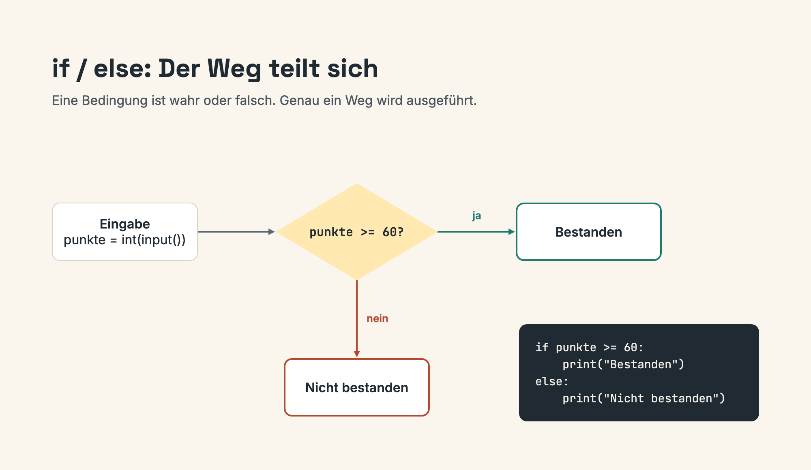
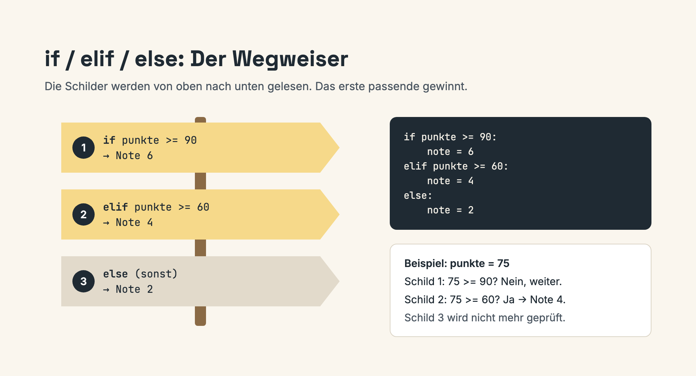

# Lektion 1: Bedingte Anweisungen

**Dauer:** 50 Minuten  
**Format:** 15 Min Theorie + 20 Min Live-Coding + 15 Min Übung

## 🎯 Lernziele

- If-Anweisungen verstehen
- If-else nutzen
- If-elif-else anwenden
- Verschachtelte Bedingungen

## 📖 Theorie (15 Min)

### If-Anweisung

```python
if bedingung:
    # Code wird nur ausgeführt wenn bedingung True ist
    print("Bedingung erfüllt")
```

### If-Else

```python
if bedingung:
    print("Bedingung erfüllt")
else:
    print("Bedingung nicht erfüllt")
```



### If-Elif-Else

```python
if bedingung1:
    print("Bedingung 1")
elif bedingung2:
    print("Bedingung 2")
else:
    print("Keine Bedingung erfüllt")
```



## 💻 Live-Coding (20 Min)

### Beispiel 1: Alterscheck

```python
alter = int(input("Wie alt sind Sie? "))

if alter >= 18:
    print("Sie sind volljährig")
else:
    print("Sie sind minderjährig")
```

### Beispiel 2: Notensystem

```python
punkte = int(input("Punkte: "))

if punkte >= 90:
    print("Note: 6")
elif punkte >= 80:
    print("Note: 5")
elif punkte >= 70:
    print("Note: 4")
else:
    print("Note: < 4")
```

### Beispiel 3: Rabatt-Rechner

```python
preis = float(input("Preis: "))
ist_mitglied = input("Mitglied? (j/n): ").lower() == "j"

rabatt = 0
if ist_mitglied:
    rabatt = 10

endpreis = preis * (1 - rabatt / 100)
print(f"Endpreis: {endpreis:.2f} CHF")
```

## ✏️ Übung (15 Min)

Siehe [Übung 1: Notensystem](../02-uebungen/uebung-1-notensystem.md)

## 📝 Zusammenfassung

- `if` für einfache Bedingungen
- `if-else` für zwei Fälle
- `if-elif-else` für mehrere Fälle
- Einrückung ist wichtig!

## 🔗 Weiter

[Lektion 2: While-Schleifen](./lektion-2-while-schleifen.md)

