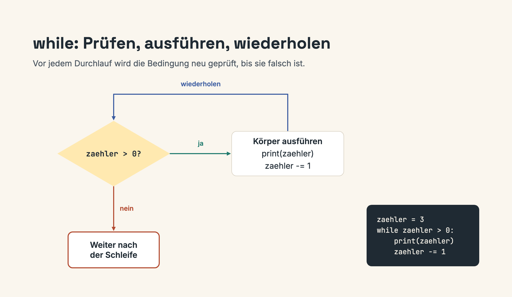

# Lektion 2: While-Schleifen

**Dauer:** 50 Minuten  
**Format:** 15 Min Theorie + 20 Min Live-Coding + 15 Min Übung

## 🎯 Lernziele

- While-Schleifen verstehen
- Zählervariablen nutzen
- Break und Continue anwenden
- Endlosschleifen vermeiden

## 📖 Theorie (15 Min)

### While-Schleife

Wiederholt Code solange Bedingung `True` ist:

```python
zaehler = 1
while zaehler <= 5:
    print(zaehler)
    zaehler += 1  # Wichtig: Bedingung muss irgendwann False werden!
```



### Break

Beendet Schleife vorzeitig:

```python
while True:
    eingabe = input("Zahl (0 = Ende): ")
    if eingabe == "0":
        break
    print(f"Sie haben {eingabe} eingegeben")
```

### Continue

Überspringt Rest der Iteration:

```python
zaehler = 0
while zaehler < 10:
    zaehler += 1
    if zaehler % 2 == 0:
        continue  # Gerade Zahlen überspringen
    print(zaehler)  # Nur ungerade Zahlen
```

### ⚠️ Endlosschleifen vermeiden

**FALSCH:**
```python
zaehler = 1
while zaehler <= 5:
    print(zaehler)
    # Fehler: zaehler wird nie erhöht!
```

**RICHTIG:**
```python
zaehler = 1
while zaehler <= 5:
    print(zaehler)
    zaehler += 1  # Bedingung wird irgendwann False
```

## 💻 Live-Coding (20 Min)

### Beispiel 1: Countdown

```python
"""Countdown von 10 bis 0"""
countdown = 10

while countdown >= 0:
    print(countdown)
    countdown -= 1

print("Start! 🚀")
```

**Erklärung:**
- Start bei 10
- Jede Iteration: Ausgabe und Dekrement
- Stoppt bei -1 (Bedingung wird False)

### Beispiel 2: Summe berechnen

```python
"""Summe von 1 bis N berechnen"""
n = int(input("Bis zu welcher Zahl summieren? "))

summe = 0
zaehler = 1

while zaehler <= n:
    summe += zaehler
    zaehler += 1

print(f"Summe von 1 bis {n}: {summe}")
```

**Erklärung:**
- Zwei Variablen: summe und zaehler
- Jede Iteration: zaehler zu summe addieren
- Formel: 1 + 2 + 3 + ... + n

### Beispiel 3: Eingabe validieren

```python
"""Zahl zwischen 1 und 10 einlesen"""
zahl = 0

while zahl < 1 or zahl > 10:
    try:
        zahl = int(input("Zahl zwischen 1 und 10: "))
        
        if zahl < 1 or zahl > 10:
            print("Ungültig! Bitte zwischen 1 und 10.")
    except ValueError:
        print("Bitte eine Zahl eingeben!")
        zahl = 0  # Zurücksetzen für nächste Iteration

print(f"Gültige Zahl: {zahl}")
```

**Erklärung:**
- Schleife läuft bis gültige Eingabe
- Try-except für Fehlerbehandlung
- Benutzerfreundliche Fehlermeldungen

## ✏️ Übungen (15 Min)

### Übung 3: Fakultät
Siehe [Übung 3: Fakultät](../02-uebungen/uebung-3-fakultaet.md)

### Übung 4: Zahlenraten
Siehe [Übung 4: Zahlenraten](../02-uebungen/uebung-4-zahlenraten.md)

## 📝 Zusammenfassung

| Konzept | Verwendung |
|---------|------------|
| `while` | Wiederholung mit Bedingung |
| `break` | Schleife vorzeitig beenden |
| `continue` | Iteration überspringen |
| Zähler | Bedingung kontrollieren |

### Wichtige Punkte

✅ **DO:**
- Bedingung muss irgendwann False werden
- Zählervariable aktualisieren
- Break für vorzeitigen Abbruch nutzen

❌ **DON'T:**
- Endlosschleifen ohne break
- Zähler vergessen zu aktualisieren
- Komplexe Bedingungen ohne Kommentare

## 🔗 Weiter

[Lektion 3: For-Schleifen & Listen](./lektion-3-for-listen.md)

