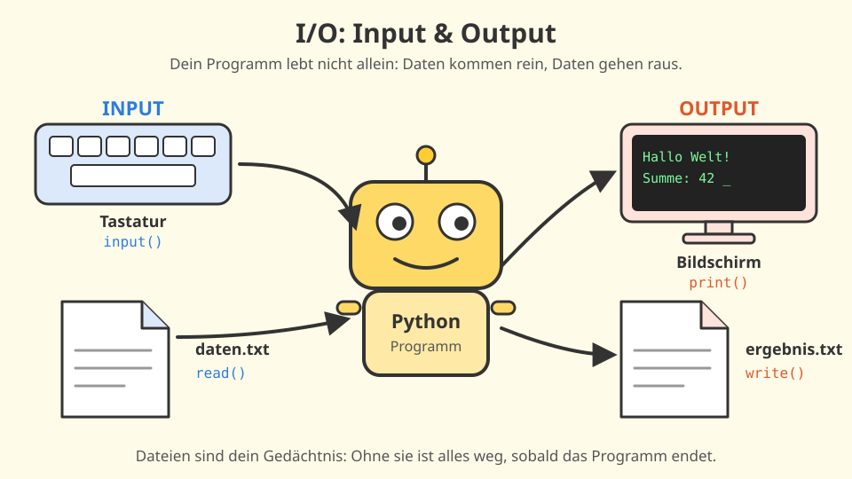
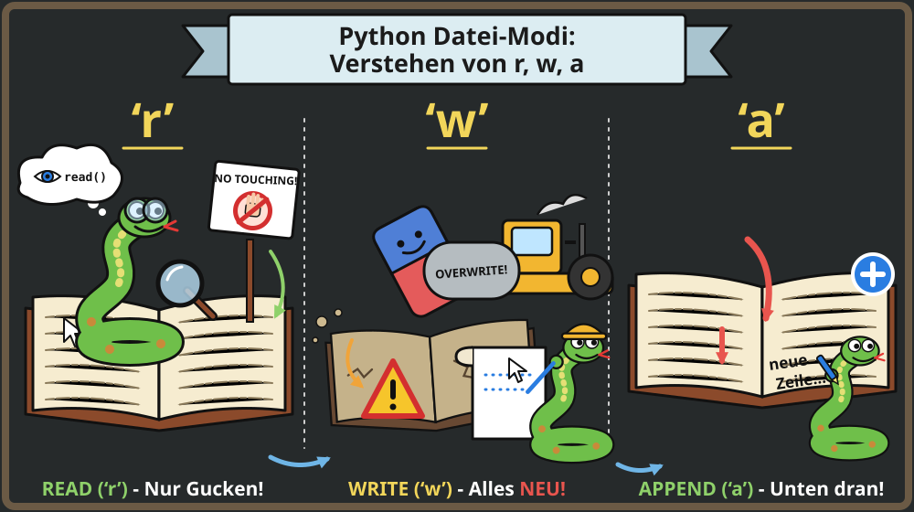
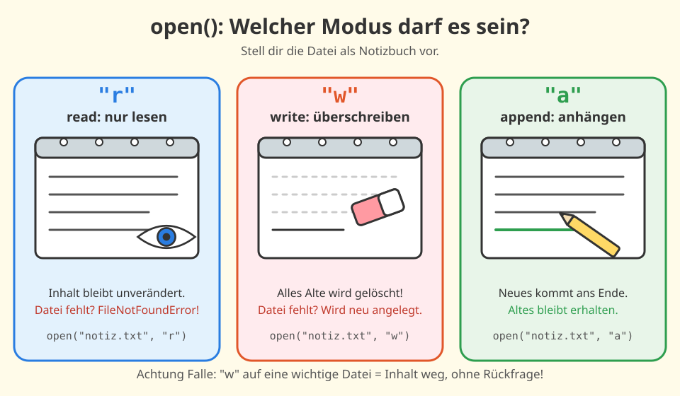
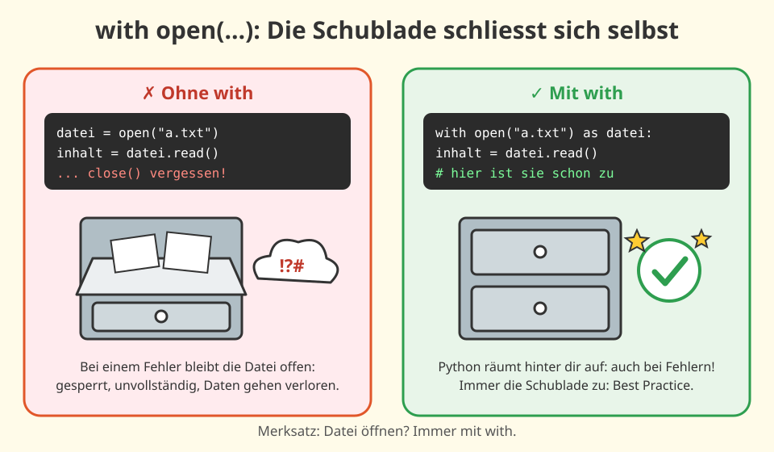

# Lektion 1: Dateien lesen & schreiben

**Dauer:** 50 Minuten  
**Format:** 15 Min Theorie + 20 Min Live-Coding + 15 Min Übung

## 🎯 Lernziele

- Textdateien öffnen und schliessen
- Dateien lesen mit verschiedenen Methoden
- In Dateien schreiben
- Context Manager (`with`) verwenden

## 📖 Theorie (15 Min)



### Dateien öffnen

```python
# Öffnen
datei = open("text.txt", "r")
inhalt = datei.read()
datei.close()  # WICHTIG!
```

### Modi

- `"r"` - Lesen (read) - Datei muss existieren
- `"w"` - Schreiben (write) - Überschreibt Datei!
- `"a"` - Anhängen (append) - Fügt am Ende hinzu
- `"r+"` - Lesen und Schreiben





### Context Manager (Best Practice!)

```python
with open("text.txt", "r") as datei:
    inhalt = datei.read()
# Datei wird automatisch geschlossen!
```



### Lesen

```python
# Alles lesen
with open("datei.txt", "r") as f:
    inhalt = f.read()

# Zeile für Zeile
with open("datei.txt", "r") as f:
    for zeile in f:
        print(zeile.strip())

# Alle Zeilen als Liste
with open("datei.txt", "r") as f:
    zeilen = f.readlines()
```

### Schreiben

```python
# Überschreiben
with open("ausgabe.txt", "w") as f:
    f.write("Erste Zeile\n")
    f.write("Zweite Zeile\n")

# Anhängen
with open("ausgabe.txt", "a") as f:
    f.write("Dritte Zeile\n")
```

## 💻 Live-Coding (20 Min)

### Beispiel 1: Tagebuch

```python
def schreibe_eintrag(text):
    """Fügt einen Tagebuch-Eintrag hinzu."""
    with open("tagebuch.txt", "a") as f:
        from datetime import datetime
        datum = datetime.now().strftime("%Y-%m-%d %H:%M")
        f.write(f"[{datum}] {text}\n")
    print("✓ Eintrag gespeichert")

def zeige_eintraege():
    """Zeigt alle Tagebuch-Einträge."""
    try:
        with open("tagebuch.txt", "r") as f:
            print("=" * 50)
            print("TAGEBUCH")
            print("=" * 50)
            for zeile in f:
                print(zeile.strip())
    except FileNotFoundError:
        print("Noch keine Einträge vorhanden.")

# Verwendung
schreibe_eintrag("Heute war ein guter Tag!")
schreibe_eintrag("Python macht Spass!")
zeige_eintraege()
```

### Beispiel 2: Textdatei analysieren

```python
def analysiere_datei(dateiname):
    """Analysiert eine Textdatei."""
    with open(dateiname, "r") as f:
        zeilen = f.readlines()
    
    anzahl_zeilen = len(zeilen)
    anzahl_woerter = sum(len(zeile.split()) for zeile in zeilen)
    anzahl_zeichen = sum(len(zeile) for zeile in zeilen)
    
    print(f"Datei: {dateiname}")
    print(f"  Zeilen: {anzahl_zeilen}")
    print(f"  Wörter: {anzahl_woerter}")
    print(f"  Zeichen: {anzahl_zeichen}")

# Test
analysiere_datei("tagebuch.txt")
```

### Beispiel 3: Datei kopieren

```python
def kopiere_datei(quelle, ziel):
    """Kopiert eine Datei."""
    with open(quelle, "r") as f_quelle:
        inhalt = f_quelle.read()
    
    with open(ziel, "w") as f_ziel:
        f_ziel.write(inhalt)
    
    print(f"✓ {quelle} → {ziel}")

kopiere_datei("tagebuch.txt", "tagebuch_backup.txt")
```

## ✏️ Übungen (15 Min)

- [Übung 1: Notizen-App](../02-uebungen/uebung-1-notizen.md)
- [Übung 2: Textstatistik](../02-uebungen/uebung-2-statistik.md)

## 📚 Zusammenfassung

- Immer `with open()` verwenden!
- Modi: `"r"` lesen, `"w"` schreiben, `"a"` anhängen
- Lesen: `read()`, `readlines()`, Zeile für Zeile
- Schreiben: `write()`, `writelines()`

## 🔗 Weiter

- [Lektion 2: CSV-Dateien](./lektion-2-csv.md)
- [Beispiele](../05-beispiele/textdateien.py)
