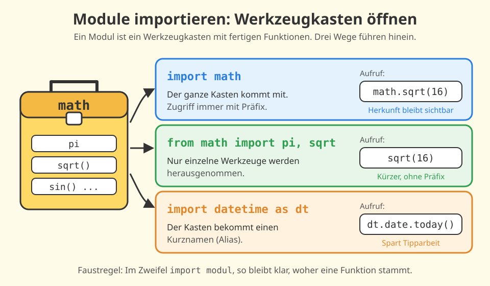
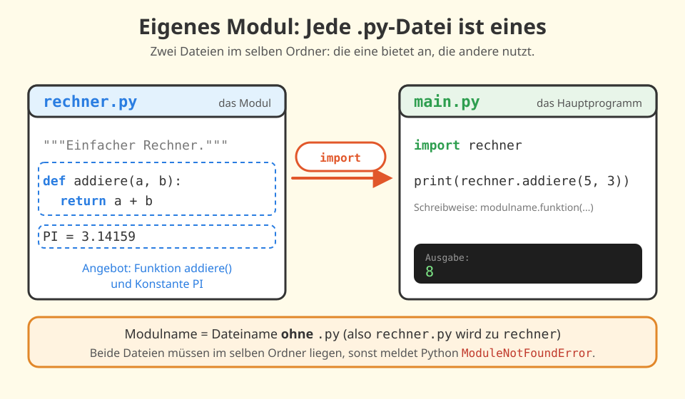
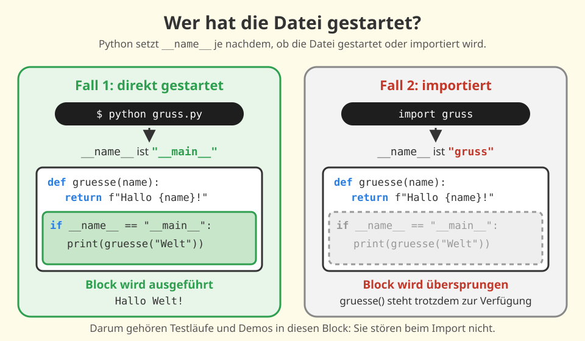
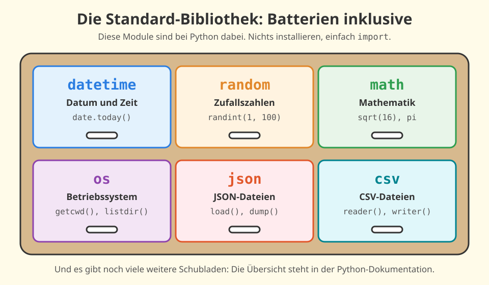
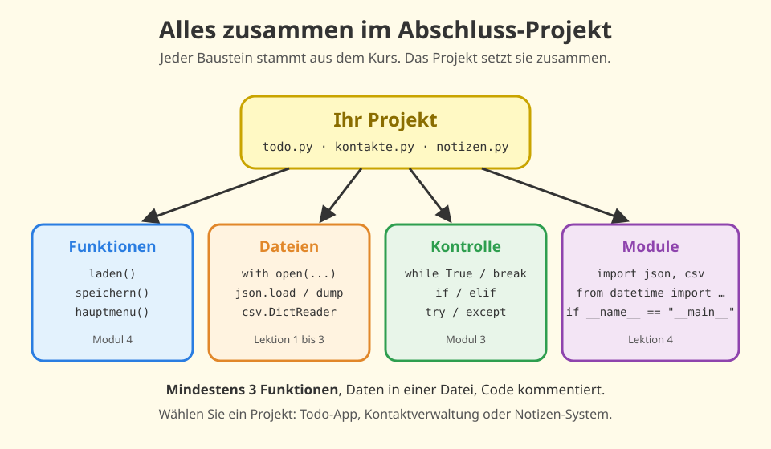
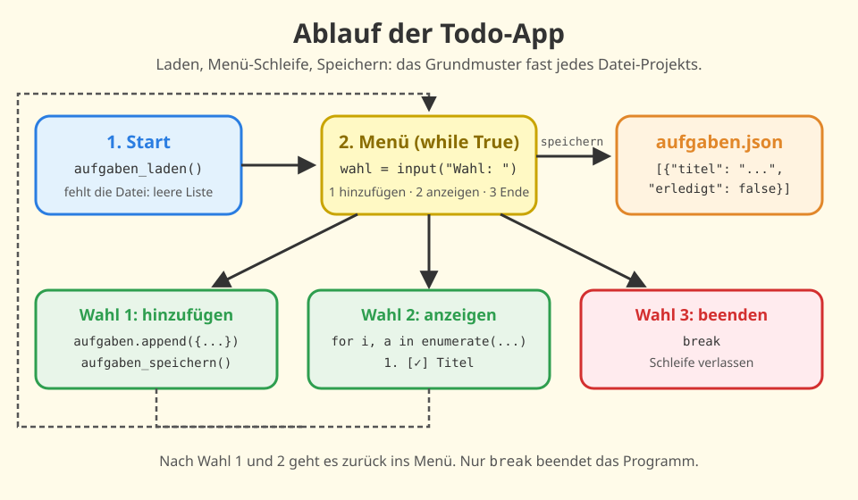

# Lektion 4: Module & Abschluss-Projekt

**Dauer:** 50 Minuten
**Format:** 10 Min Theorie + 15 Min Live-Coding + 25 Min Projekt

## 🎯 Lernziele

- Module importieren
- Eigene Module erstellen
- Standard-Bibliothek nutzen
- Alle Konzepte in einem Projekt kombinieren

## 📖 Theorie (10 Min)

### Was sind Module?

Module sind **Python-Dateien** mit wiederverwendbarem Code.

### Importieren



```python
# Ganzes Modul
import math
print(math.pi)
print(math.sqrt(16))

# Spezifische Funktionen
from math import pi, sqrt
print(pi)

# Mit Alias
import datetime as dt
heute = dt.date.today()
```

### Eigenes Modul erstellen



Datei `rechner.py`:
```python
"""Einfacher Rechner."""

def addiere(a, b):
    return a + b

PI = 3.14159
```

Verwendung:
```python
import rechner
print(rechner.addiere(5, 3))
```

### `if __name__ == "__main__":`



```python
def gruesse(name):
    return f"Hallo {name}!"

# Wird nur ausgeführt wenn direkt gestartet
if __name__ == "__main__":
    print(gruesse("Welt"))
```

### Wichtige Standard-Module



```python
import datetime   # Datum/Zeit
import random     # Zufallszahlen
import os         # Betriebssystem
import math       # Mathematik
import json       # JSON-Dateien
import csv        # CSV-Dateien
```

## 💻 Live-Coding (15 Min)

### Beispiel 1: Eigenes Modul

Datei `texttools.py`:

```python
"""Werkzeuge für Textverarbeitung."""

def woerter_zaehlen(text):
    return len(text.split())

def gross_schreiben(text):
    return text.upper()

if __name__ == "__main__":
    print(woerter_zaehlen("Hallo Welt"))
```

### Beispiel 2: Standard-Module nutzen

```python
import datetime
import random

heute = datetime.date.today()
print(f"Heute: {heute}")

zahl = random.randint(1, 100)
print(f"Zufallszahl: {zahl}")
```

---

## 📋 Abschluss-Projekt (25 Min)

Wählen Sie **eines** der folgenden Projekte:



### Projekt 1: Aufgabenverwaltung (Todo-App)



```python
import json

def aufgaben_laden():
    try:
        with open("aufgaben.json", "r") as f:
            return json.load(f)
    except FileNotFoundError:
        return []

def aufgaben_speichern(aufgaben):
    with open("aufgaben.json", "w") as f:
        json.dump(aufgaben, f, indent=2)

def hauptmenu():
    aufgaben = aufgaben_laden()

    while True:
        print("\n=== TODO-APP ===")
        print("1. Aufgabe hinzufügen")
        print("2. Alle anzeigen")
        print("3. Beenden")

        wahl = input("Wahl: ")

        if wahl == "1":
            titel = input("Titel: ")
            aufgaben.append({"titel": titel, "erledigt": False})
            aufgaben_speichern(aufgaben)
        elif wahl == "2":
            for i, a in enumerate(aufgaben, 1):
                status = "✓" if a["erledigt"] else " "
                print(f"{i}. [{status}] {a['titel']}")
        elif wahl == "3":
            break

if __name__ == "__main__":
    hauptmenu()
```

### Projekt 2: Kontaktverwaltung

```python
import csv

def kontakte_laden():
    try:
        with open("kontakte.csv", "r") as f:
            return list(csv.DictReader(f))
    except FileNotFoundError:
        return []

def kontakte_speichern(kontakte):
    with open("kontakte.csv", "w", newline="") as f:
        writer = csv.DictWriter(f, ["name", "email", "telefon"])
        writer.writeheader()
        writer.writerows(kontakte)

# Hauptprogramm ähnlich wie Todo-App
```

### Projekt 3: Notizen-System

```python
import json
from datetime import datetime

def neue_notiz(titel, inhalt):
    notizen = notizen_laden()
    notizen.append({
        "titel": titel,
        "inhalt": inhalt,
        "datum": datetime.now().isoformat()
    })
    notizen_speichern(notizen)
```

## ✅ Erfolgskriterien

- [ ] Programm läuft ohne Fehler
- [ ] Daten werden in Datei gespeichert
- [ ] Mindestens 3 Funktionen implementiert
- [ ] Code ist kommentiert

## 📚 Zusammenfassung

- Module mit `import` einbinden
- Eigene Module = .py Dateien
- `if __name__ == "__main__":` für Tests
- Wichtige Standard-Module: datetime, random, os, math, json, csv

## 🎉 Herzlichen Glückwunsch!

Sie haben den Python-Einführungskurs abgeschlossen!

**Sie können jetzt:**

- ✅ Python-Programme schreiben
- ✅ Mit Datentypen arbeiten
- ✅ Kontrollstrukturen nutzen
- ✅ Funktionen definieren
- ✅ Datenstrukturen verwenden
- ✅ Dateien verarbeiten
- ✅ Module erstellen

**Weiter:** [Hausaufgaben](../03-nachbearbeitung/)
